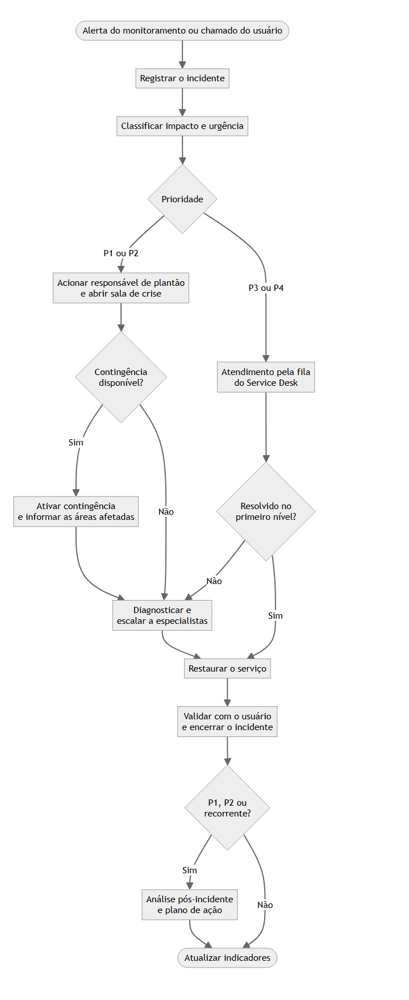

# Processo de gestão de incidentes

**Objetivo:** restaurar o serviço o mais rápido possível, com o menor impacto para a operação. Encontrar a causa raiz é importante, mas vem depois: durante a crise, a prioridade é voltar a operar.

## Fluxo de atendimento

Fonte editável do diagrama: [fluxo-atendimento.mmd](../assets/fluxo-atendimento.mmd).

## Matriz de criticidade
A prioridade combina dois critérios objetivos, o que reduz a discussão durante a crise e evita que tudo seja tratado como urgente.

| Impacto \ Urgência | Alta | Média | Baixa |
| --- | --- | --- | --- |
| **Alto** | **P1** | **P2** | **P3** |
| **Médio** | **P2** | **P3** | **P4** |
| **Baixo** | **P3** | **P4** | **P4** |

| Critério | Nível | Quando se aplica |
| --- | --- | --- |
| Impacto | Alto | Serviço crítico parado, risco à segurança das pessoas ou à continuidade da operação |
| | Médio | Uma área ou unidade afetada, com alternativa de trabalho limitada |
| | Baixo | Um usuário ou um pequeno grupo, com alternativa disponível |
| Urgência | Alta | O dano cresce a cada minuto e não há contorno |
| | Média | Há contorno temporário, mas o prazo é curto |
| | Baixa | A atividade pode aguardar sem prejuízo relevante |

## Metas de atendimento (SLA)
Os valores são uma **referência de partida**, contados em horário corrido. Eles devem ser calibrados com as áreas de negócio conforme o risco e a capacidade da equipe.

| Prioridade | Primeira resposta | Restauração | Comunicação às áreas afetadas |
| --- | --- | --- | --- |
| P1 | 15 min | 4 h | A cada 30 min |
| P2 | 30 min | 8 h | A cada 2 h |
| P3 | 2 h | 24 h | Ao mudar de situação |
| P4 | 8 h | 72 h | Ao encerrar |

## Papéis e escalonamento
| Papel | Responsabilidade |
| --- | --- |
| Service Desk | Registra, classifica, faz o primeiro atendimento e acompanha até o encerramento |
| Gestor do incidente | Coordena a crise, decide sobre contingência e garante a comunicação; não precisa ser quem executa o reparo |
| Especialistas | Diagnosticam e executam a restauração |
| Coordenação ou gerência de TI | Remove obstáculos, aciona fornecedores e informa a diretoria |
| Fornecedor | Atua conforme o contrato, acionado pelo gestor do incidente |

| Gatilho | Ação |
| --- | --- |
| P1 aberto | Acionar o gestor do incidente e a coordenação de imediato |
| 50% do prazo de restauração consumido em P1 ou P2 | Escalar para a gerência e cobrar o fornecedor envolvido |
| Prazo de restauração vencido | Informar a diretoria e reavaliar a contingência |
| Suspeita de incidente de segurança | Acionar o responsável por segurança e preservar as evidências antes de alterar os sistemas |

## Continuidade operacional
Incidente e continuidade se encontram em uma pergunta: **quanto tempo a operação suporta ficar sem este serviço, e como ela trabalha enquanto isso?**

| Classe do serviço | Exemplo de perfil | RTO (tempo para voltar) | RPO (perda de dados tolerada) |
| --- | --- | --- | --- |
| Crítica | Parada interrompe a atividade-fim | Até 4 h | Até 15 min |
| Importante | Parada afeta setores, com contorno manual | Até 8 h | Até 4 h |
| Apoio | Parada não afeta a atividade-fim no curto prazo | Até 72 h | Até 24 h |

Valores de referência: a definição real vem de uma análise de impacto no negócio, feita com as áreas usuárias.

**Práticas que sustentam a continuidade**
1. Manter inventário de serviços críticos, com dono, dependências e fornecedores.
2. Documentar o plano de contingência de cada serviço crítico, incluindo o procedimento manual das áreas usuárias.
3. Definir critérios claros de ativação e de retorno, além de quem decide.
4. Testar failover e restauração de backup periodicamente: contingência que nunca foi testada é só uma hipótese.
5. Manter os contatos de plantão e de fornecedores acessíveis também quando a rede estiver fora do ar.

## Incidentes com dados pessoais
Quando houver suspeita de dados pessoais envolvidos, o encarregado de dados (DPO) e o jurídico devem ser acionados logo no início. A LGPD e a regulamentação da ANPD estabelecem critérios e prazos para comunicar incidentes de segurança relevantes; a avaliação de cada caso cabe a essas áreas.

## Encerramento e melhoria
Incidentes P1, P2 ou recorrentes geram uma [análise pós-incidente](../templates/analise-pos-incidente.md), sem busca de culpados e com ações que tenham responsável e prazo. O acompanhamento é feito pelos [indicadores](indicadores.md).
