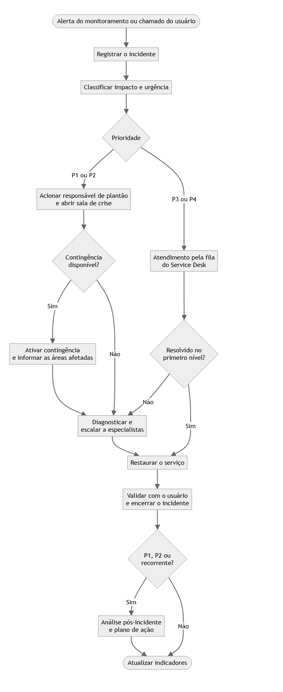

# Portfólio de Gestão de TI

**Marcelo Bastoni** | Gestão de TI • Infraestrutura • Sistemas Corporativos • Transformação Digital

Este portfólio reúne a forma como abordo a gestão de operações de tecnologia: metodologias, modelos e estudos de caso sobre manter serviços críticos no ar, decidir com base em indicadores e conectar a TI aos resultados do negócio.

## Comece por aqui
**[Gestão de Incidentes e Continuidade Operacional](01-gestao-incidentes/README.md):** fluxograma de atendimento, matriz de criticidade, SLA, indicadores e uma [simulação completa de falha de conectividade](01-gestao-incidentes/simulacao-falha-conectividade.md), da detecção à análise pós-incidente e à leitura gerencial.

## Áreas do portfólio
| Área | Foco | Situação |
| --- | --- | --- |
| [01. Gestão de incidentes](01-gestao-incidentes/README.md) | Incidentes, prioridades, SLA e continuidade | Disponível |
| [02. Indicadores de TI](02-indicadores-ti/README.md) | KPIs, relatórios e dashboards | Em construção |
| [03. Infraestrutura](03-infraestrutura/README.md) | Redes e conectividade | Em construção |
| [04. Segurança da informação](04-seguranca-informacao/README.md) | Políticas e controles | Em construção |
| [05. Transformação digital](05-transformacao-digital/README.md) | Estudos de caso e integração de sistemas | Em construção |
| [06. Gestão de fornecedores](06-gestao-fornecedores/README.md) | Escopos e critérios de contratação | Em construção |
| [Modelos](templates/README.md) | Documentos reutilizáveis | Disponível |

## Como ler este material
Cada estudo indica claramente o seu tipo:

- **Caso real anonimizado:** baseado em experiência profissional, sem identificar a organização, pessoas, fornecedores ou sistemas internos.
- **Exercício simulado:** cenário e números fictícios, criados para demonstrar a aplicação de um método.

Todos seguem a [estrutura padrão de estudo de caso](templates/estudo-de-caso.md) ou a adaptam ao exercício, e passam pelo [checklist de confidencialidade](templates/checklist-confidencialidade.md) antes da publicação.

## Competências
Gestão de TI • Infraestrutura • C#/.NET • SQL • APIs • Projetos • Segurança da Informação • IA aplicada

## Projetos técnicos
- [EscolaTI](https://github.com/marcelobastoni/EscolaTI): API para gestão de uma escola de tecnologia.
- [ProEventos](https://github.com/marcelobastoni/ProEventos): API para cadastro de eventos.

## Contato
- [LinkedIn](https://www.linkedin.com/in/marcelobastoni)
- [GitHub](https://github.com/marcelobastoni)
